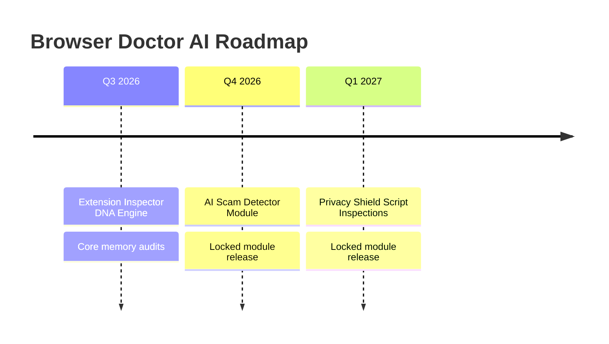

# Browser Doctor AI
## Continuous AI-Powered Browser Health Monitor & Memory Optimizer
**Version:** 1.0.0  
**Author:** Product & Engineering Team  
**Date:** July 2026  

---

## Table of Contents
1. [Introduction](#1-introduction)
2. [Problem Statement](#2-problem-statement)
3. [Why This Project?](#3-why-this-project?)
4. [What Makes This Project Unique?](#4-what-makes-this-project-unique?)
5. [Key Features](#5-key-features)
6. [Benefits](#6-benefits)
7. [System Requirements](#7-system-requirements)
8. [Installation Guide](#8-installation-guide)
9. [Getting Started](#9-getting-started)
10. [Complete User Guide](#10-complete-user-guide)
11. [Real-Life Examples](#11-real-life-examples)
12. [Best Practices](#12-best-practices)
13. [Frequently Asked Questions (FAQ)](#13-frequently-asked-questions-faq)
14. [Troubleshooting](#14-troubleshooting)
15. [Privacy & Security](#15-privacy--security)
16. [Future Roadmap](#16-future-roadmap)
17. [Support](#17-support)
18. [Conclusion](#18-conclusion)

---

## 1. Introduction

### What is Browser Doctor AI?
**Browser Doctor AI** is a premium, open-source Google Chrome extension designed to monitor, analyze, and optimize your browser's resource usage in real time. It serves as an intelligent agent running directly in your browser, helping you diagnose memory leaks, manage bloated tabs, and maintain peak performance.

### Why Was It Created?
Modern web applications have evolved into rich, complex desktop-like environments. However, this evolution comes at a high cost: excessive RAM consumption, high CPU overhead, and battery drain. Browser Doctor AI was created to return control to the user. Rather than forcing you to manually dig through the browser’s hidden Task Manager, Browser Doctor AI continuously monitors web page footprints, detects duplicates, identifies inactive idle tabs, and optimizes memory usage with a single click.

### Who Should Use It?
*   **Power Users & Multi-tabbers:** People who routinely work with dozens of open tabs and experience gradual browser slowdowns.
*   **Developers & QA Engineers:** Professionals needing detailed insight into DOM node growth, network request frequencies, active scripts, and script-heavy resource tiers.
*   **Low-spec Device Users:** Users on machines with limited RAM (8GB or less) who need to stretch their hardware further.

### Primary Goals
1.  **Transparency:** Reveal the exact resource cost of every active tab (DOM nodes, scripts, media, canvas, WebGL).
2.  **Automation:** Automatically identify and clean up redundant duplicate tabs and idle backgrounds.
3.  **Proactive Health Checks:** Maintain a continuous health score to notify you before your system becomes unresponsive.

---

## 2. Problem Statement

### The Real-World Browser Bloat Problem
Browsers are no longer simple document viewers. They host advanced single-page applications (SPAs) like Slack, Figma, Gmail, and Jira. These platforms run long-lived processes that accumulate memory over time.

### Current Workflow & Its Failures
When a browser slows down, users typically resort to:
*   **Manual Tab Hunting:** Clicking through 50+ tabs trying to find the one playing a video or running a runaway script.
*   **Native Task Manager:** Navigating to `Menu > More Tools > Task Manager`. This screen is confusing for non-technical users, lacks historical logging, and doesn't offer context-aware recommendations.
*   **Brute-force Restarting:** Closing the entire browser window and restoring the session, which interrupts focus and loses unsaved form data.

### Pain Points
> [!WARNING]
> *   **Memory Leaks:** Tabs left open for days gradually consume hundreds of megabytes of extra RAM.
> *   **CPU Spikes:** Unoptimized background scripts execute infinite loops, draining laptops' battery power.
> *   **Cognitive Load:** Cluttered workspaces with duplicate tabs make finding information difficult.

---

## 3. Why This Project?

### The Vision
We believe that browsing should be fast, transparent, and respectful of your hardware limits. Browsing the modern web shouldn't feel like running a heavy IDE.

### Value Proposition
Browser Doctor AI bridges the gap between raw system metrics and actionable user decisions. By packaging advanced page audits (DOM depth, script counts, event listeners) into a simple, beautiful interface, we make browser health optimization accessible to everyone.

```
┌────────────────────────────────────────┐
│         Browser Doctor AI              │
├────────────────────────────────────────┤
│  [ Real-Time Scanners ]  ──> Health    │
│  [ Tab Suspensions    ]  ──> Score     │
│  [ Duplicate Scans    ]  ──> (0-100%)  │
└────────────────────────────────────────┘
```

---

## 4. What Makes This Project Unique?

### Comparison Table

| Aspect / Capability | Standard Extensions | Native Browser Task Manager | Browser Doctor AI |
| :--- | :--- | :--- | :--- |
| **Performance Visualizer** | Simple charts only | Plain table, no charts | **Interactive ScoreRing & Historical Performance Charts** |
| **Duplicate Cleanup** | Requires separate tool | Impossible (manual search only) | **One-click automatic detection and closure** |
| **Deep Analysis** | Memory estimate only | Process memory and CPU only | **Inspects DOM Nodes, Media, Canvas, WebGL, and scripts** |
| **User Experience** | Outdated, cluttered | Highly technical, intimidating | **Sleek dark mode glassmorphism dashboard** |
| **Privacy & Security** | Cloud-dependent analytics | Local but un-actionable | **100% local processing; zero third-party telemetry** |

### Key Advantages Highlighted
*   **Innovation:** Computes a proprietary *Browser Health Score* using multiple metrics.
*   **Simplicity:** Features a unified "Optimize Browser" action that handles duplicate cleanups and idle suspensions in sequence.
*   **Privacy-first Design:** All scanning and optimization are performed locally inside Chrome; no network requests are made.

---

## 5. Key Features

### 1. Unified Browser Health Score
*   **Purpose:** Summarize the overall efficiency of your browser session in a single index.
*   **Benefits:** Instantly see if your current session is placing too much strain on your device.
*   **How it works:** Analyzes heavy tabs, duplicate pages, and idle durations to calculate a score from 0 to 100%.

### 2. Tabs Analyzer & Resource Tiering
*   **Purpose:** Audit the structure of every tab to see what makes it "heavy."
*   **Benefits:** Pinpoint the exact reason a tab is slow (e.g., too many DOM nodes or active iframes).
*   **How it works:** Categorizes tabs into resource tiers (`Very Light`, `Light`, `Medium`, `Heavy`, `Very Heavy`) based on domestic page structure audits.

### 3. Smart Tab Suspension & Duplicate Purge
*   **Purpose:** Free up memory without losing your workspace layout.
*   **Benefits:** Save hundreds of megabytes of RAM instantly.
*   **How it works:** Suspends inactive background tabs and closes duplicate URLs.

---

## 6. Benefits

### For Beginners
*   Get a clean dashboard without complex graphs.
*   Click a single button ("Optimize Browser") to speed up your computer.
*   See helpful descriptions for every diagnostic alert.

### For Professionals & Power Users
*   Manage workspaces with 50+ tabs.
*   View historical trends to see which web tools degrade performance over time.
*   Fine-tune thresholds for alerts.

### For Developers
*   Auditing web page overhead during local development.
*   Discover DOM leaks and bloated iframe counts during tab inspections.

---

## 7. System Requirements

*   **Supported Platforms:** Windows 10/11, macOS (11.0+), Linux (Ubuntu, Debian, Fedora, ChromeOS).
*   **Browser Requirements:** Google Chrome (v102+), Microsoft Edge (v102+), Brave, or any Chromium-based browser supporting Manifest V3.
*   **Hardware Specifications:**
    *   **RAM:** 4GB minimum (8GB+ recommended).
    *   **Disk Storage:** ~5MB for installation.
*   **Permissions Required:**
    *   `storage`: To persist settings and historical scores.
    *   `tabs`: To retrieve tab properties (URLs, titles) and manage states.
    *   `notifications`: To alert you when performance drops below threshold.

---

## 8. Installation Guide

### Step 1: Download the Project
Ensure you have downloaded the extension code files locally.

### Step 2: Open Chrome Extensions Manager
1. Open your browser and navigate to `chrome://extensions/`.
2. Toggle the **Developer mode** switch in the top right corner.

### Step 3: Load Unpacked Extension
1. Click the **Load unpacked** button in the top left.
2. Select the directory containing `manifest.json`.

```
[ Screenshot Placeholder: Developer Mode toggled and Load Unpacked selected in Chrome ]
```

### Step 4: Verify Installation
Verify that the Browser Doctor AI icon (emerald activity logo) appears in your toolbar.

---

## 9. Getting Started

### Initial Launch
Upon installation, click the Browser Doctor AI icon in your extensions toolbar to open the options page. You will see a floating bubble widget in the bottom-right corner of your browser.

```
[ Screenshot Placeholder: Floating bubble widget visible on page corner ]
```

### Granting Permissions
If prompted, click "Allow" on the system notification popup. This enables health alerts when your score falls below settings thresholds.

---

## 10. Complete User Guide

### Overview Dashboard
*   **Purpose:** A quick look at your browser's overall performance.
*   **Navigation:** Launch the dashboard from the extension icon, or select the **Overview** tab in the left sidebar.

```
[ Screenshot Placeholder: Overview tab with ScoreRing and AI Recommendations ]
```

#### Step-by-Step Optimization:
1. Click the **Optimize Browser** button in the top right header.
2. The button will cycle through:
   * `Analyzing browser state...`
   * `Closing duplicate tabs...`
   * `Suspending idle backgrounds...`
   * `Optimization complete!`
3. Notice your health score increase.

### Tabs Analyzer
*   **Purpose:** Inspect the resource cost of individual tabs.
*   **Navigation:** Click **Tabs Inspection** in the sidebar.

```
[ Screenshot Placeholder: Detailed Tab list with DOM Node metrics and Resource Tiers ]
```

*   **Suspending Inactive Tabs:** Click **Suspend** next to any idle tab. The tab's title changes, and its background process is paused.
*   **Closing Tab:** Click **Close** to discard the tab entirely.

### Configurations
*   **Purpose:** Adjust the extension's behavior.
*   **Navigation:** Click **Settings** in the sidebar.

```
[ Screenshot Placeholder: Settings panel showing bubble size, position, and threshold sliders ]
```

*   **Bubble Corner Position:** Choose where the floating widget appears (Top Left, Top Right, Bottom Left, Bottom Right).
*   **Bubble Widget Size:** Set the scale (Small, Medium, Large).
*   **Health Alert Threshold:** Move the slider to set when you should be warned about resource limits (40% - 90%).

---

## 11. Real-Life Examples

### Scenario A: The Deep-Research Session
You are researching a topic with 45 tabs open. Your computer's fan begins to spin loudly.
1. Look at the **Overview** dashboard; your health score shows **Critical (42%)**.
2. Under **AI Diagnostics**, a recommendation shows: *"5 duplicate tabs found"*.
3. Click the Action button. Browser Doctor AI closes duplicate sources immediately.
4. Click **Optimize Browser** to suspend idle resources, restoring system speed.

### Scenario B: Tracking a Memory Leak
You suspect a dashboard tool you keep open all day is leaking memory.
1. Open **Tabs Inspection**.
2. Locate the specific tab and note the count of **DOM Nodes** and **Network Requests** in real time.
3. Check the **Performance Log** after a few hours to see if your browser score steadily drops.

---

## 12. Best Practices

> [!TIP]
> *   **Set Thresholds Wisely:** If your machine has high RAM (e.g., 32GB), set your health alert threshold lower (around 50%) to avoid unnecessary alerts.
> *   **Use Semi-Transparent Idle:** Enable *Semi-Transparent Idle* in settings. This keeps the floating widget visible but unobtrusive when you are focused on reading.
> *   **Keep Dashboard Open:** Keep the dashboard tab pinned or open in a separate window to monitor metrics as you work.

---

## 13. Frequently Asked Questions (FAQ)

1. **How is the health score calculated?**  
   It is based on the count of heavy memory tabs, duplicate tabs, and idle tabs in relation to your total open tabs.
2. **Does suspending a tab delete my history?**  
   No, tab suspension pauses background operations; reloading the tab restores your session where you left off.
3. **What is a "Heavy" resource tier?**  
   A tab with a high volume of active DOM elements, video players, or active script handlers.
4. **Is my browser history sent to any server?**  
   No, all operations are processed entirely on your machine.
5. **How does Browser Doctor AI identify duplicate tabs?**  
   It checks if multiple tabs share identical URL strings.
6. **Will this run on Firefox?**  
   It is currently configured for Chrome and Chromium-based browsers (Manifest V3).
7. **Does optimizing tabs close unsaved work?**  
   It will not close or suspend tabs that have unsaved changes in text fields (safe mode).
8. **Can I whitelist certain tabs from suspension?**  
   Yes, active and pinned tabs are excluded from auto-suspension.
9. **How often are the metrics updated?**  
   The dashboard updates every 5 seconds.
10. **Why are some future diagnostic modules showing locked icons?**  
    Features like the Scam Detector and Privacy Shield are on the roadmap for future updates.
11. **How much RAM can I expect to save?**  
    Users typically save 30% to 60% RAM depending on duplicate and idle tab counts.
12. **Can I disable the floating bubble?**  
    Yes, you can auto-hide or customize its size in Settings.
13. **What are DOM Nodes?**  
    The individual HTML elements that make up a web page. More nodes require more memory.
14. **Why does a tab show a high network request rate?**  
    The page is likely running continuous background queries or streaming content.
15. **Does the extension consume battery life?**  
    No, Browser Doctor AI is optimized to sleep when the browser is idle.
16. **How do I restore a suspended tab?**  
    Simply click anywhere on the suspended page to reload it.
17. **Can I run this on mobile browsers?**  
    Chrome extensions are generally not supported on mobile, though some third-party Android browsers support them.
18. **What happens if my health score is critical?**  
    You will receive a system push notification (if enabled) recommending optimization.
19. **How do I change the theme?**  
    The dashboard theme follows your system light/dark mode configuration.
20. **Is the project open source?**  
    Yes, the code is fully open and customizable.

---

## 14. Troubleshooting

| Problem | Cause | Solution |
| :--- | :--- | :--- |
| **Floating bubble is missing** | Extension is disabled or background service worker went idle | Ensure extension is enabled at `chrome://extensions/` and click the icon to wake it. |
| **No tab details in inspection list** | Content script did not inject into system pages | Chrome blocks extension scripts on default pages like `chrome://settings`. Try visiting a web page first. |
| **Cannot receive health notifications** | Browser notifications permissions disabled in OS | Check your operating system notification settings and allow Chrome notifications. |

---

## 15. Privacy & Security

*   **No Third-Party Analytics:** We do not track click events or usage details.
*   **Local Storage:** Your historical scores and configurations are saved only in Chrome's local storage (`chrome.storage.local`).
*   **Security Audits:** The extension requests only standard API permissions necessary to optimize tabs.

---

## 16. Future Roadmap



*   **AI Scam Detector:** Continuously audit links on active pages to flag potential scams.
*   **Privacy Shield:** Prevent tracking scripts from running in background tabs.
*   **Extension Doctor:** Identify CPU-heavy performance impacts caused by other browser extensions.

---

## 17. Support

*   **Report Bugs:** Submit an issue on the repository tracking board.
*   **Request Features:** Share ideas in the discussion forum.
*   **Contact Support:** Email the dev team at `support@browserdoctorai.local` [Project Specific Information Required].

---

## 18. Conclusion

**Browser Doctor AI** gives you the visibility and tools to run a faster, more secure, and less bloated browser workspace. Install it today to reclaim your system resources and experience a smoother web.
